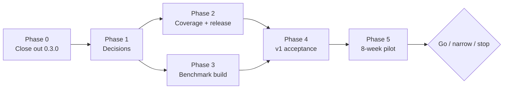

# Compass — Project Status & Roadmap

Oct 8, 2026, audited again Oct 14, 2026 · @Uvesh · Compass 0.3.0 (branch `m7-installer-languages`, in review)

## About this document

The five specs say what Compass should be and how to build and judge it. This document says **where the project stands against them**: what is built and proven, what is built but unproven, what is missing, what needs a decision, and in what order to do the rest. It is the one place to look before planning the next piece of work.

It was made by reading every document in the repository against the code: the five `Compass — *.md` specs, `CLAUDE.md`, `README.md`, `plugin/README.md`, the guides in `docs/`, `bench/README.md` and the code and tests. Each status names its evidence, so it can be checked. Statuses use these marks:

| Mark | Meaning |
| --- | --- |
| ✅ Done | Built, with automated tests and, where the plan asks for it, a passing real-session check |
| 🟡 Built, unproven | Code and unit tests exist, but a required live check, measurement or audit has not happened |
| 🟠 Partial | Part of the requirement is built |
| ⬜ Not started | Nothing built yet |
| ⏸ Deferred | Recorded for later discussion; not planned |

Keep this document current: tick items in [section 7](#7-pending-work) as they close, and update the tables when a status changes.

---

## 1. Compass in one page

**The problem.** AI-assisted development loses time and tokens in five predictable places: vague requests, editing before questions are answered, expensive exploration of the codebase, outdated technology choices, and output too large to review properly (Requirements Spec, "Problem and goals").

**The idea.** Route each piece of work to the cheapest executor that can do it correctly, and make every AI change reviewable. Most of the saving comes from Tier 0: work that never reaches a model costs nothing.

| Tier | Executor | Handles |
| --- | --- | --- |
| 0 | Scripts (the Python core) | Code map, lookups, range reads, folder trees, manifests, gates |
| 1 | Local LLM (optional) | Summaries of undocumented code, bulk classification; background only |
| 2 | Haiku subagents | Test runs, log and large-file digests, mechanical edits from a spec |
| 3 | Main model | Design, logic, judgment, anything ambiguous |

**The shape.** Three layers. A **plugin** holds no logic; every hook is `compass hook <event>`. The **core** (`src/compass/`) does all the work for hooks, the MCP server, the CLI and CI. The **state** lives in `.compass/` in each repository: config and standards are committed, everything else is derived. Everything runs on the developer's machine, through Claude Code and the developer's own Claude login. There is no server and no API key.

**What a developer sees.**
1. Claude looks code up in a code map instead of opening whole files.
2. A vague new request makes Claude ask one short question with its best guess. The prompt always goes through.
3. A large task starts with a short plan that the developer approves.
4. Tests and heavy reading go to Haiku subagents.
5. Every change is tagged in the code and listed in a review manifest, and a commit that still carries tags is refused.
6. Eleven skills (code review, security review, debugging and more) work in any stack.
7. Telemetry measures what all of this costs and saves.

**The rules that never bend** (CLAUDE.md, "Invariants"):
- fail open
- never turn a prompt away
- no network calls in hooks
- SQLite is the source of truth and Markdown shards are the view
- deterministic output
- built on Claude Code, never an API key
- public extension points only
- stdio-only MCP
- no Must requirement depends on a local LLM
- GitHub and Azure DevOps are both first class
- a new language or stack never touches core code

---

## 2. Where the project stands

### Milestones

| Milestone | Scope | Status | Evidence |
| --- | --- | --- | --- |
| M1 Index core | File list, stack profile, tree-sitter indexer with ctags fallback, SQLite, map shards, incremental updates | ✅ | Snapshot and determinism tests per fixture; perf tests on a generated 100k LOC repo (`pytest --perf`) |
| M2 Query tools | MCP server and CLI twins: `find_symbol`, `read_symbol`, `file_outline`, `map`, `stack_profile`, `tests_for`, `importers_of`, `callers_of` | ✅ | `tests/e2e/check_query_tools.py` passed 2026-09-24: answered with zero Read/Grep/Glob calls |
| M3 Plugin + review | Hooks, commands, subagent, output style, anchors, manifests, pre-commit check, `compass accept` | ✅ | `check_review_loop.py` passed on the Python, TypeScript and Go fixtures |
| M4 Gates | Prompt gate (never rejects), context pack, spec gate, `/compass:task`, `/compass:approve` | ✅ | `check_gates.py` passed (rerun once the gate stopped turning prompts away) |
| M5 Delegation | `digest`, `test-runner`, `scaffold` with output contracts; local-LLM tools and enrichment | ✅ | `check_delegation.py`: a 623-line test run came back as 8 lines, 3 of 3 runs |
| M6 Measurement | Telemetry from transcripts, `compass report`, benchmark harness | ✅ | Telemetry rows matched Claude Code's own token counts exactly; the harness ran the example tasks on and off |
| M7 Installer | `compass install` / `upgrade` / `doctor` / extended `uninstall`; plugin and files modes; npm wrapper; `install.ps1` and `install.sh`; release jobs | ✅ | `tests/e2e/check_install.py` passed Oct 14 on Windows in both modes: install, `doctor`, a session answered through the query tools with zero Read calls, `upgrade` kept an edited file, `uninstall` left git status and the user's settings unchanged, and `doctor` caught a doubled install. `install.sh` not yet run; release jobs built but never run |
| Skill library | 11 agnostic skills, team overrides in `.compass/standards/` | 🟡 | `claude plugin validate --strict` passes; shape test in `tests/test_plugin.py`. `code-review` ran in real sessions in both modes (Oct 14); the other ten have not |

**Test suite (rerun Oct 14 after the language and installer work, Windows, 376 s):** 703 passed, 29 skipped. Before T2 was accepted, `test_compass_itself_carries_no_anchor_tags` failed on its 103 open tags; it passes now that they are stripped.

**The only measured result so far** comes from a five-file fixture, so it is a harness check, not evidence. There, Compass used 16% more main-model tokens than stock on a lookup task (64k against 55k), but finished faster (10.6 s against 13.2 s). That was down from +44% before the query tools were always loaded. The overhead (session context, delegation) only pays off on large repositories, which is why the real benchmark needs repos of 50k LOC or more.

### Repository health

| Item | State |
| --- | --- |
| Branch | 0.3.0 (installer, skills, the six new languages, release jobs, spec updates) committed on Oct 14 on `m7-installer-languages` and pushed for a pull request into `main`; its CI run is the first on any M7 code |
| Open review | None. Task T2 was accepted on Oct 14: its 103 tags (52 review, 6 assumptions, 2 TODO, 43 mechanical) were stripped and the manifest archived in `.compass/changes/archive/T2.md`, which keeps the notes |
| CI | GitHub Actions: macOS, Ubuntu, Windows × Python 3.11/3.12; Azure Pipelines defined identically but never run (no Azure DevOps organisation yet) |
| Weekly compatibility job | Defined on both systems (Mondays 06:17 UTC); needs the `CLAUDE_CODE_OAUTH_TOKEN` secret, so its status is unknown |
| Spec exports | The `.docx`/`.pdf` copies one folder up predate M1 |
| This machine | `uv` still not on PATH (the tests run from `.venv`); `compass` 0.3.0 is on PATH, but the installed plugin is still the 0.2.0 cache; Claude Code is now 2.1.299. The Compass MCP server timed out (30 s) at the start of two sessions, although `compass doctor` passes and a warm start answers in about 1.5 s: the tool environment was installed without bytecode, so those first starts compiled its dependencies (diagnosed Oct 14; reinstalling with `--compile-bytecode` is pending) |

### Since the last audit (Oct 8 → Oct 14)

- **Nothing closed in section 7 except documentation.** No commit, no decision, no hands-on installer test. The doc fixes listed in [7.6](#76-documentation-fixes) are done, and the audit found more drift (now fixed): the Proposal still called the installer "planned" and put the build at 7 weeks against its own table's 8.5; the Getting Started guide and the installer plan named the wheel folder `compass/_plugin/` (it is `compass/_bundle/`); the installer plan listed an `install/upgrade.py` that does not exist.
- **Dogfooding has not exercised the code map.** `compass report` on this repository's telemetry (Oct 7–14, 2 tasks, 15 prompts): **0 Compass tool calls**, 2.5 Read/Grep/Glob calls and heavy Bash use per task, because the MCP server never connected. The prompt gate behaved: 0 `!quick` bypasses (target under 20%) and 2 prompts where Claude checked with the developer first. Until the server connects, this repository's telemetry says nothing about Tier 0.
- **Claude Code moved 18 releases** (2.1.281 at the last live checks, 2.1.299 now) with no e2e rerun and no weekly job.
- **Later on Oct 14, phase 2's build work closed:**
  - **The six NF-09 languages.** Java, Kotlin, Swift, Dart, C# and C/C++ landed with their stack detectors (`INDEX_FORMAT` 3).
  - **The M7 release jobs.**
  - **`tests/e2e/check_install.py`.** It passes in both modes, and on its first runs it found two real plugin-mode bugs, both fixed:
    - `compass uninstall` left `.claude/settings.json` behind, holding the marketplace and an empty `enabledPlugins`. Uninstall now removes a marketplace Compass added and restores or deletes that settings file.
    - A `uvx` install pointed the marketplace into uv's cache, which never sees an upgrade.
  - **A third problem the check surfaced.** uv reused its first build of a checkout until `pyproject.toml` changed, so `uvx --from <clone>` and `install.ps1` ran stale code after a pull. `[tool.uv] cache-keys` now covers `src/` and `plugin/`.
  - **The MCP timeout was diagnosed:** the first start compiled the server's dependencies. Every install path now precompiles them, and `doctor` times the server's start.
  - **Live checks.** `install.ps1` by hand, `code-review` in real sessions in both modes, and `CLAUDE_PLUGIN_ROOT` in a live session all passed.

---

## 3. Requirements status

### Functional requirements

| Component | Requirements | Status | Notes |
| --- | --- | --- | --- |
| C1 Prompt gate | PG-01 to PG-05 | ✅ | Ask / strict / off; `!quick` bypass logged; `/compass:task` |
| | PG-06 local-model clarity score (Could) | ⬜ | |
| C2 Context pack | CP-01 to CP-03 | ✅ | Names resolved against the index; 1,500-token budget; "did you mean" |
| | CP-04 git hotspots (Could) | ⬜ | |
| C3 Spec gate | SG-01 to SG-05 | ✅ | Approval lives in `state.json`, so Claude cannot approve its own spec |
| C4 Indexer | IX-01 to IX-12 | ✅ | Imports resolved to files; tests mapped by convention and imports; stack detectors for Maven, Gradle, .NET, SwiftPM, Dart/Flutter and CMake added Oct 14 (IX-10) |
| | IX-13 TODO/env/config index, IX-14 churn, IX-15 `compass watch` (Could) | ⬜ | |
| C5 Query tools | QT-01 to QT-05 | ✅ | Always loaded in Claude Code 2.1 (no ToolSearch round trip) |
| C6 Delegation | DL-01 to DL-06 | ✅ | Contracts enforced by SubagentStop; scaffold held to its files |
| C7 Review output | RO-01 to RO-05 | ✅ | |
| C8 Standards | ST-01 standards as skills, repo or org (Must) | 🟠 | Per-repo half done through ST-04 to ST-06; no org-wide source and no owner |
| | ST-02 real dependency versions at session start | ✅ | |
| | ST-03 docs MCP server (Could) | ⬜ | |
| | ST-04 to ST-06 skill library, one shape, team overrides | 🟡 | Built and validated; `code-review` ran in real sessions in both modes on Oct 14 (loaded, arguments filled, query tools, zero Read calls). The other ten skills and the team overrides are untried |
| C9 Telemetry & setup | TM-01 to TM-03, CF-01 to CF-04 | ✅ | Telemetry-only baseline possible (every module off but telemetry) |
| C10 Installer | IN-01 to IN-12, IN-14, IN-15 | ✅ | `tests/e2e/check_install.py` passed on Oct 14 in both modes (Windows, Claude Code 2.1.299), after it found and fixed two plugin-mode bugs (see [since the last audit](#since-the-last-audit-oct-8--oct-14)) |
| | IN-13 distribution through both hosts | 🟠 | Release jobs built on both CI systems (Oct 14) and gated by `scripts/check_release.py`. Feeds decided (Azure Artifacts); still needed: the package names (D1a) and the Azure DevOps organisation and feeds |
| Deferred | WF-01 phase workflow, AG-01 personas, MT-01 other agents | ⏸ | Need an in-depth discussion first |

### Non-functional requirements

| ID | Target | Status | What is missing |
| --- | --- | --- | --- |
| NF-01 to NF-04 | Latency budgets (gate 100 ms, pack 300 ms, full index 60 s, update 500 ms) | 🟡 | Perf tests exist on a generated repo; release acceptance needs a recorded run on the 100k LOC **reference** repo |
| NF-05 | Shards at most 2,000 tokens | ✅ | Directories split automatically |
| NF-06, NF-07 | −30% tokens, at most +5% time | ⬜ | Only measurable with the real benchmark |
| NF-08 | macOS, Linux, Windows without WSL | ✅ | All three in CI |
| NF-09 | 10 languages with full tags queries | ✅ | **10 of 10** (Oct 14): Java, Kotlin, Swift, Dart, C# and C/C++ joined Python, TypeScript/JavaScript, Go and Rust, each with a fixture, snapshots and query tests. Some imports stay unresolved by design (C# `using`, Swift modules, Dart `package:`, C/C++ includes outside `./` and `../`); CLAUDE.md lists them |
| NF-10 | No code leaves the machine except through Claude Code | 🟡 | Designed and tested (loopback only, proxies bypassed); the audit is not done |
| NF-11 | stdio MCP; hooks run only Compass's code | 🟡 | Designed; the review is not done |
| NF-12 | Fail open | ✅ | Hook-contract tests |
| NF-13 | Deterministic output | ✅ | Byte-identical rebuild tests |
| NF-14 | Weekly test against the latest Claude Code | 🟡 | Job defined; needs the secret; supported range not documented |
| NF-15 | Index + shards at most 50 MB per 100k LOC | 🟡 | Perf test exists; record it with NF-01 to NF-04 |
| NF-16 | GitHub and Azure DevOps first class | 🟠 | Both CI definitions and hosted links done; Azure Pipelines never actually run; package feeds not chosen |

### Goals (Requirements Spec, G1–G5)

None are measured yet. G1 (−25% correction prompts), G2 (−30% tokens), G3 (at most +5% time) and G4 (review in under 5 minutes) come from the benchmark and the pilot. G5 (10 languages, no per-project code) is met in code since Oct 14 (NF-09); the pilot repos will show whether the coverage holds on real code.

---

## 4. The road to a decision

The Proposal asks for an 8-week pilot ending in a go / narrow / stop decision. Getting there takes five phases, each with an exit criterion:

| Phase | What it covers | Exit criterion |
| --- | --- | --- |
| **0. Close out 0.3.0** | Review and accept T2, commit on a branch, hands-on test of the installer and skills, fix this machine's setup | 0.3.0 merged; installer and skills used successfully in a real session, in both modes |
| **1. Decisions** | Product name, package feeds, standards owner, pilot team and repos, data policy, seats | The owner decisions in [section 5](#5-decisions-needed) are made |
| **2. Coverage and release** | ~~Six missing languages and their stack detectors (NF-09); release jobs and the install e2e check (M7 leftovers)~~ (done Oct 14); the org standards source (ST-01); the first tagged release | A tagged release publishes to the chosen feeds; the org standards reach `.compass/standards/` |
| **3. Benchmark build** | Two 50k+ LOC repos, 20 tasks with hidden acceptance tests, written by someone who did not build Compass | `bench/run.py` runs the full suite end to end |
| **4. v1 acceptance** | The six release-acceptance checks, the privacy audit and security review, the recorded latency and footprint run | Every box under "Release acceptance" in the Requirements Spec is ticked |
| **5. Pilot** | Weeks 1–2 baseline (`--modules baseline`); weeks 3–4 roll-out; week 4 checkpoint; weeks 5–7 tuning; week 8 survey, rerun and report | The decision rule: **go** at −20% tokens or better with at most +5% time and no drop in pass rate; **narrow** between 10% and 20%; **stop** below 10% or above +10% time |

Phases 2 and 3 run in parallel once phase 1 settles the repos and the feeds.

---

## 5. Decisions needed

| # | Decision | Blocks | Source |
| --- | --- | --- | --- |
| ~~D1~~ | ~~Final product name~~ **Decided Oct 14: Compass** | | Requirements Spec, open questions |
| D1a | Package names (new, Oct 14): both placeholders are taken publicly by unrelated projects (PyPI `compass`, npm `compass-cc`), so the published names must differ, e.g. `@<org>/compass` on npm and a prefixed Python distribution name; the `compass` command and import stay | The first release (IN-13), the npm wrapper's name | Requirements Spec, open questions |
| ~~D2~~ | ~~Package feeds~~ **Decided Oct 14: Azure Artifacts**, one Python and one npm feed | Next: an Azure DevOps organisation, project and the two feeds (none exist yet), then `PYTHON_FEED_URL` and `NPM_FEED_URL` on the release pipeline | IN-13, NF-16 |
| D3 | Where the org-wide standards pack lives and who owns it (still open on Oct 14) | ST-01 (Must) | Requirements Spec; Proposal next steps |
| D4 | Pilot team (3–6 developers), repos in at least two stacks, local-LLM hardware (still open on Oct 14) | Benchmark repos, pilot start | Proposal; Evaluation Plan |
| D5 | Security and data-policy review; whether telemetry export is acceptable | Pilot start | Proposal; Requirements Spec |
| D6 | Claude Code plan and seats for the pilot team, and a usage budget for 120+ benchmark sessions | Benchmark, pilot | Proposal; `bench/README.md` |
| D7 | Approve the pilot at about 8.5 engineer-weeks (7 for M1–M6, 1.5 for M7) | Everything after phase 1 | Proposal, "Decision requested" |
| D8 | Python only, or port hot paths to Go or Rust | Not blocking; revisit after the pilot | ADR 004 |
| D9 | Whether `strict` becomes the prompt gate's default | Not blocking; decide from the pilot's gate log | Requirements Spec |
| D10 | Whether to take up WF-01, AG-01 or MT-01 | Not blocking; each needs an in-depth discussion | `docs/installer-plan.md` |
| D11 | Move ADRs 001–009 from Proposed to Accepted, or revise them | Not blocking; good hygiene before v1 | Architecture doc |

---

## 6. Risks to watch now

| Risk | Why it matters now | Mitigation |
| --- | --- | --- |
| Overhead beats savings on small repos | The only measurement (a five-file fixture) shows +16% tokens | The real benchmark on 50k+ LOC repos; keep session-start context lean; measure the skills before they reach the pilot |
| Developers switch Compass off | The top project risk in the Proposal | The gate never rejects a prompt; `!quick`; tune from `gate.jsonl` (bypass under 20%); the `baseline` preset for a gentle start |
| Claude Code changes under Compass | Hooks, plugin and transcript formats move fast (tested on 2.1.281, running 2.1.299) | Set the weekly-job secret; rerun `tests/e2e/run_all.py` and record the result |
| The code map silently never reaches Claude | The MCP server timed out at start-up in two of this machine's sessions; Claude then works stock with nothing to say so, and Tier 0, the main saving, is gone. The cause was the first start compiling the server's dependencies (Oct 14), so every install path now precompiles them; corporate Windows machines with heavy scanning, like the pilot's, may still start slowly | `compass doctor` times the server's start (fails past 30 s, warns past 10 s); confirm a cold start after a fresh install on a pilot machine; have `compass report` flag sessions where Compass was on but no Compass tool was called |
| Files mode and plugin mode drift apart | Two install paths for the same behaviour | One source (`plugin/`), tests that the installed tree matches it, `compass doctor` |
| New languages unproven on real code | The six NF-09 languages added Oct 14 are tested on small fixtures only, with some imports unresolved by design | Index one real repository per pilot stack before the pilot and check the map and `tests_for` by hand |

---

## 7. Pending work

Each item lists its priority (🔴 blocks the pilot or v1 · 🟠 before a wider rollout · 🟢 nice to have), its owner (Dev or Owner), and its source.

### 7.1 Phase 0: close out 0.3.0

- [x] 🔴 **Dev**: Review `.compass/changes/T2.md`, then run `/compass:accept T2`. *(Oct 14, approved by the owner)*
- [x] 🔴 **Dev**: Commit on a branch, with the executable bit on `install.sh` (`git add --chmod=+x install.sh`); open a PR. *(Oct 14: `m7-installer-languages`, pushed; the PR is opened from GitHub's link, since `gh` is not installed here. `docs/init-cheatsheet.md` was left out, see below.)*
- [x] 🔴 **Dev**: Test `install.ps1` hands-on in a second repository, in both modes, then `compass doctor`, `compass upgrade --skip-cli` and `compass uninstall`. *(Oct 14, in a sandbox with its own HOME, Claude config and uv tool folder, on a ts_app copy: both modes installed, `doctor` said "All good", upgrade and uninstall ran cleanly, and git status matched the starting point apart from `.compass/`. Sessions in both modes are covered by `check_install.py`, 7.2.)*
- [x] 🔴 **Dev**: Try the skills in a real session: `/compass:code-review` (plugin) and `/compass-code-review` (files). Check that they load, that `$ARGUMENTS` is filled in, and that they use the query tools rather than Read. *(Oct 14, on a python_app copy with a planted bug in an uncommitted `LRUCache.put` and a harmless edit elsewhere, the path to the buggy file as the argument. Both modes: the skill was listed, its expanded text read `Request: src/inventory/_internal/cache.py`, and Claude used `file_outline`, `callers_of`, `importers_of`, `tests_for` and more with **zero Read calls** (plugin: 4 Compass calls, 39 s; files: 7, 59 s). Both reviews found the planted eviction bug and the off-by-one, with line numbers, and listed the missing tests.)*
- [x] 🟠 **Dev**: Verify that Claude Code sets `CLAUDE_PLUGIN_ROOT` for plugin hooks (IN-11, IN-14). *(Oct 14, Claude Code 2.1.299: the plugin session's telemetry row recorded `install_mode: plugin`, which only that variable produces, and the files session's `files`.)*
- [ ] 🟠 **Dev**: Run `install.sh` on macOS and Linux. *(Plugin mode against the real `claude` CLI is done: `check_install.py`, Oct 14.)*
- [ ] 🟠 **Dev**: Fix this machine: uv on PATH, reinstall the 0.3.0 plugin, restart, and check that the MCP server connects.
- [x] 🔴 **Dev** (added Oct 14): Find why the MCP server times out at session start on this machine (two sessions in a row; `compass doctor` passes; a warm start takes about 1.5 s). *(Oct 14: `uv tool install` writes no bytecode by default, so the first start after an install or an upgrade compiles pydantic, the MCP SDK, anyio, httpx and cryptography. The `__pycache__` timestamps in the tool environment fall inside both failed connection windows, and on this machine that work outlasted Claude Code's 30 s connect limit. Every install path now passes `--compile-bytecode` (`compass install`, `compass upgrade`, `install.ps1`, `install.sh`, the npm wrapper), and `compass doctor` times the server's start: it fails past 30 s and warns past 10 s.)*
- [ ] 🟠 **Dev** (added Oct 14): Once the server connects, rerun `compass report` on this repository and check that Compass tool calls are above zero.
- [ ] 🟠 **Owner**: Share the original code-review prompt to merge into `plugin/skills/code-review/SKILL.md` (a TODO tag marks the spot).
- [ ] 🟠 **Dev**: Decide whether `docs/init-cheatsheet.md` (untracked) is committed; if so, update it for `compass install`, `doctor` and the skills.

### 7.2 Phase 2: coverage and release

- [x] 🔴 **Dev, NF-09**: Tags queries, fixture and snapshot for **Java, Kotlin, Swift, Dart, C#, C/C++**. *(Oct 14; `INDEX_FORMAT` 3. Core changes they needed, all language-neutral: the owner placed before the name when a signature starts with its return type, XML doc and Javadoc markup out of summaries, and Kotlin docs that the grammar folds into the package header. The original four fixtures' snapshots did not change.)*
- [x] 🟠 **Dev, IX-10**: Stack detectors for Maven/Gradle, .NET, Swift Package Manager, Dart/Flutter, CMake. *(Oct 14)*
- [ ] 🟠 **Dev, ST-01**: Pull an org-wide standards source into `.compass/standards/` (after D3).
- [x] 🟠 **Dev, M7 step 10**: Release jobs in `.github/workflows/release.yml` and `azure-pipelines-release.yml`, kept in step by `tests/test_ci_configs.py`. *(Oct 14; a `v*` tag tests, builds the wheel, sdist and npm tarball, and runs `scripts/check_release.py`, which checks the tag, the four version files and the bundled plugin. Each feed publishes only once its secret or variable is set, so nothing goes out before D1 and D2. Neither job has run yet: the first tag will be their test.)*
- [x] 🟠 **Dev, M7 step 11**: `tests/e2e/check_install.py` (a real install in both modes, then a lookup through `find_symbol`), added to `run_all.py`. *(Oct 14; passed on Windows. It found two bugs, both fixed; see [since the last audit](#since-the-last-audit-oct-8--oct-14).)*
- [ ] 🔴 **Owner, D1a** (added Oct 14): Choose the published package names (the PyPI and npm placeholders are taken by other projects), then **Dev** renames them in `pyproject.toml`, `npm/package.json`, the installer's pin and the docs.
- [ ] 🔴 **Owner, D2** (added Oct 14): Create the Azure DevOps organisation and project, a Python feed and an npm feed, and the release pipeline from `azure-pipelines-release.yml`; set `PYTHON_FEED_URL` and `NPM_FEED_URL`.
- [ ] 🟠 **Dev** (added Oct 14): Run the two release jobs for the first time: push a throwaway tag on a fork (or a `workflow_dispatch` run) with no feed secrets set, and check that the GitHub release gets the three artifacts.
- [ ] 🟠 **Dev**: Run the npm wrapper's automated test on Windows as well.
- [ ] 🟢 **Dev**: A `/compass:doctor` command.
- [ ] 🟢 **Dev, IN-15** (added Oct 14): A fresh `compass install` writes the preset config and then runs `init`, which reports "config .compass/config.yaml exists; kept as is". Have the installer's output say the preset was written instead.
- [ ] 🟢 **Dev, IN-05** (added Oct 14): `compass upgrade` writes `<file>.compass-new` beside an edited file even when Compass's own version of it did not change (`record.plan_files` compares the file on disk with the new content only). Skip it when the new content's hash equals the recorded one.
- [ ] 🟠 **Dev, TM-03** (added Oct 14): Have `compass report` flag sessions where Compass was on but no Compass tool was called, so a server that never connected shows up in the numbers.
- [ ] 🟢 **Dev, Could items**: PG-06, CP-04, IX-13, IX-14, IX-15, ST-03.

### 7.3 Phase 3: benchmark build

- [ ] 🔴 **Owner/Pilot**: Repo A (internal, 50k+ LOC) and Repo B (public, a different language, 50k+ LOC), listed in `bench/repos.yaml`.
- [ ] 🔴 **Pilot**: 20 tasks in the plan's mix (4 locate, 4 bug fix, 4 small feature, 3 refactor, 3 tests, 2 triage), from real closed tickets, each with a hidden acceptance test, fixed before any ON run.
- [ ] 🟠 **Dev**: Decide whether the skills are a benchmark condition of their own.
- [ ] 🟠 **Dev**: Pin the Compass and Claude Code versions for the whole run, and record both.

### 7.4 Phase 4: v1 acceptance (Requirements Spec, "Release acceptance")

- [ ] 🔴 Traceability: every Must requirement mapped to an automated test or a documented manual check.
- [ ] 🔴 `compass init` succeeds on 5 reference repos in at least 4 languages.
- [ ] 🔴 One installer command gives a working session on clean macOS, Linux and Windows, in both modes; uninstall leaves no diff.
- [ ] 🔴 `pytest --perf` on the 100k LOC reference repo: record NF-01 to NF-04 and NF-15 with the date and machine.
- [ ] 🔴 Disabling Compass restores stock Claude Code, with no leftover hooks, in both modes.
- [ ] 🔴 The benchmark runs end to end and produces the report.
- [ ] 🟠 The NF-10 privacy audit and the NF-11 security review.
- [ ] 🟠 NF-14: set `CLAUDE_CODE_OAUTH_TOKEN`, confirm the weekly job is green, and document the supported Claude Code range.
- [ ] 🟠 NF-16: run Azure Pipelines at least once (it needs an Azure DevOps organisation and an agent).

### 7.5 Phase 5: pilot

- [ ] 🟠 **Pilot, weeks 1–2**: Baseline with `compass install --modules baseline`; collect `telemetry.jsonl`.
- [ ] 🟠 **Pilot, weeks 3–7**: Roll out the modules; tune the gate weekly from `.compass/logs/gate.jsonl`; record review time per manifest.
- [ ] 🟠 **Pilot, week 4**: Checkpoint; stop if token savings are under 15%.
- [ ] 🟠 **Pilot, week 8**: Survey (Evaluation Plan, five questions), benchmark rerun, `compass report`, recommendation.

### 7.6 Documentation fixes

- [x] 🟠 `README.md` status: "M1 to M6 are done". Add M7 and the skills. *(Oct 14)*
- [x] 🟠 `plugin/README.md`: "three commands, three subagents", and no mention of files mode or skills. *(Oct 14; install now leads with `compass install`)*
- [x] 🟠 `docs/user-guide.md`: add `compass install`, `upgrade`, `doctor`, the eleven skills and `.compass/standards/`, with sample output captured from a real session. *(Oct 14; install, doctor, upgrade and uninstall output captured in files mode in a throwaway repo, and a real `code-review` answer from the skills check in 7.1)*
- [x] 🟠 `docs/setup-guide.md`: `compass --version  # compass 0.2.0` becomes 0.3.0. *(Oct 14; also real `compass doctor` output, `compass upgrade`, what `compass uninstall` now removes, and an MCP start-up timeout row in Troubleshooting)*
- [x] 🟢 Requirements Spec: bump "Version: Draft 0.1"; cross-reference "Out of scope: other agents" with MT-01. *(Oct 14; now Draft 0.2)*
- [x] 🟢 Evaluation Plan: `/task` becomes `/compass:task`, `/approve` becomes `compass approve`, and the pilot's baseline weeks name `--modules baseline`. *(Oct 14)*
- [x] 🟢 Proposal: the installer is no longer "planned"; the build total reads 8.5 weeks, as its table does; the pilot weeks no longer include building. *(Oct 14)*
- [x] 🟢 Getting Started guide and installer plan: build status per milestone and per Step 10 piece; the wheel folder is `compass/_bundle/`, not `compass/_plugin/`; upgrade lives in `install/installer.py`. *(Oct 14)*
- [ ] 🟢 CLAUDE.md: rerun `tests/e2e/run_all.py` on the current Claude Code, and update the done-when results (from 2026-09-24, Claude Code 2.1.281; 2.1.299 is current).
- [ ] 🟢 `docs/init-cheatsheet.md`: still untracked and still written for `compass init` by hand (see 7.1).
- [ ] 🟢 Regenerate the `.docx`/`.pdf` exports one folder up.

---

## 8. Deferred for review

Recorded in the Requirements Spec ("Deferred for review") and `docs/installer-plan.md`. None is planned until discussed.

| ID | Idea (from) | The question to settle first |
| --- | --- | --- |
| WF-01 | Phase workflow: project, roadmap and state files; discuss, plan, execute and verify commands (GSD) | How much tasks, the spec gate and manifests already cover, and whether extra planning turns earn back their tokens |
| AG-01 | Agent personas: analyst, architect, QA (BMAD) | Persona prompts cost the tokens Compass exists to save; the skill library may already cover the need |
| MT-01 | Install targets for Codex, Gemini CLI, Cursor, OpenCode (GSD, BMAD) | ADR 001 and the v1 non-goal; which features survive without Claude Code's hooks |

---

## 9. Document map

| Document | Read it for |
| --- | --- |
| `Compass — Proposal for Adoption.md` | The business case, the pilot plan, the go / no-go criteria |
| `Compass — Requirements Specification.md` | Every requirement ID and NF target; the v1 contract |
| `Compass — Architecture & Technical Design.md` | Layers, tiers, storage, config, installation, ADRs 001–009 |
| `Compass — Getting Started Development Guide.md` | Milestones M1–M7 and the build steps |
| `Compass — Evaluation & Metrics Plan.md` | The benchmark protocol, metrics and decision rule |
| **`Compass — Project Status & Roadmap.md`** (this one) | Where things stand, what is next, what needs deciding |
| `CLAUDE.md` | Working rules, invariants and implementation notes, for anyone (or any agent) changing the code |
| `docs/setup-guide.md`, `docs/user-guide.md` | Installing and using Compass |
| `docs/installer-plan.md` | M7's design, the GSD/BMAD comparison, the deferred ideas |
| `bench/README.md` | The benchmark harness and the task format |
| `plugin/README.md` | What each piece of the plugin does |
