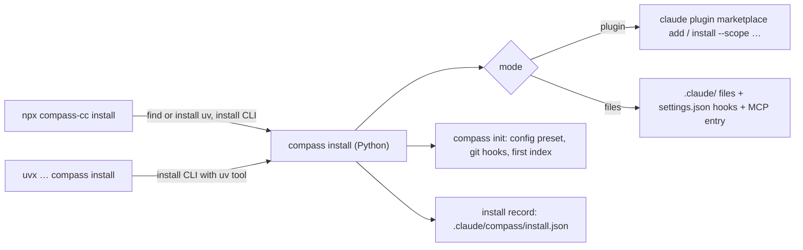

# Compass installer plan (M7)


Oct 7, 2026 · @Uvesh · Status: **built in 0.3.0**; the release jobs publish nothing until the package names and feeds are decided

Today, setting Compass up takes four steps: `uv tool install`, `claude plugin marketplace add`, `claude plugin install`, then `compass init` in each repository. This plan turns that into one command, the way GSD (`npx get-shit-done-cc`) and BMAD (`npx bmad-method install`) install. It also adds the upgrade, uninstall and health-check commands that a one-command install needs.

The requirements are **IN-01 to IN-15** in the Requirements Spec (component C10). The design is ADR 009 and "Installation and distribution" in the Architecture doc, and the build steps are Step 10 (milestone M7) in the Getting Started guide. This file holds the reasoning and the work breakdown behind those.

Three ideas from GSD and BMAD are recorded for later review and are **not** part of M7: a phase workflow, agent personas, and install targets for other agents and IDEs. See [Later, for review](#later-for-review).

## Goals

1. **One command, any OS.** On a machine with Claude Code and either uv or Node, one command gives a working Compass: the CLI on PATH, the Claude Code integration loaded, and the current repository initialised. It works natively on macOS, Linux and Windows (NF-08).
2. **Installed the way the team wants.** The integration goes in either as a Claude Code plugin (today's route) or as plain files in `.claude/` that a team commits once, so everyone who clones the repository gets the commands, agents and hooks.
3. **Upgrades keep local edits.** A team that edits a Compass command or agent keeps the edit through an upgrade.
4. **Uninstall leaves nothing behind.** Removing Compass restores every file it touched (extending CF-04).
5. **Nothing changes at run time.** The installer only writes files. Hooks, the MCP server and every invariant in `CLAUDE.md` stay exactly as they are: fail open, no network in hooks, public extension points only, no API key.

## What we take from GSD and BMAD, and what we leave

| Idea | Source | In Compass |
| --- | --- | --- |
| `npx <pkg>` as the install command | both | Yes, as a thin wrapper. The real installer is `compass install` in Python, so `uvx` works without Node (ADR 009) |
| Global (`~/.claude`) or project (`./.claude`) install | GSD | Yes: scopes `user`, `project` and `local` (IN-03) |
| Interactive prompts, with every prompt also available as a flag | BMAD | Yes (IN-04); flags plus `--yes` for scripts and CI |
| Pick which modules to install | BMAD | Yes, as config presets `full`, `baseline` and `custom` (IN-15). Every module is already a switch in `config.yaml` |
| A file manifest with hashes, so updates keep customisations | BMAD (files manifest), GSD (local patch backup) | Yes: the install record (IN-05) |
| Uninstall | both | Yes, driven by the install record (IN-07) |
| An update check at session start | GSD | **No.** That is a network call in a hook (NF-10, an invariant). Upgrades happen only when someone runs `compass upgrade` |
| Several agent runtimes (OpenCode, Gemini, Codex, Cursor…) | GSD, BMAD | **Later, for review.** See below |
| Spec-driven phases (`.planning/`, discuss → plan → execute → verify) | GSD | **Later, for review** |
| Agent personas (analyst, PM, architect, dev, QA) | BMAD | **Later, for review** |

## User experience

The transcripts below were written as the design target before M7 was built, and are not captured output. The real output is in `docs/setup-guide.md` and `docs/user-guide.md`, as their rule requires.

```text
$ npx compass-cc install                      # or: uvx --python 3.12 --from git+https://github.com/<owner>/<repo> compass install
Compass 0.3.0 installer
  uv          found (0.9.4)
  compass     installing 0.3.0 with uv tool … done (on PATH: ~/.local/bin/compass)
  claude      found (Claude Code 2.1.292)

? Install for:  (1) just me, every project  (2) this repository, for the whole team  [2]
? Install as:   (1) Claude Code plugin  (2) files in .claude/  [1]
? Modules:      (1) full  (2) baseline: telemetry only  (3) choose each  [1]
? Install git hooks (keep the map fresh, refuse commits that still carry review tags)? [Y/n]
  local model  none answering on localhost (switch it on later in .compass/config.yaml)

  plugin      compass@compass-marketplace installed (scope: project)
  init        .compass/config.yaml written; 5 git hooks; indexed 412 files in 3.1 s
  record      .claude/compass/install.json

Done. Restart Claude Code here, then run `compass doctor`.
Commit .claude/ and .compass/config.yaml so the team gets Compass too.
```

Non-interactive, for scripts, CI and the benchmark:

```bash
compass install --yes --scope project --mode files --modules full
compass install --dry-run             # print every file it would write, change nothing
compass upgrade                       # newer CLI with uv, then refresh the installed files
compass doctor                        # what is installed, and is it wired correctly
compass uninstall                     # this repository: git hooks plus whatever the install record lists
compass uninstall --scope user        # the user-scope install
```

## Design

### Two entry points, one installer



- **`compass install`** (Python, `src/compass/install/`) does all the work. A Node wrapper with logic of its own would split behaviour across two languages, against the "all behaviour lives in the core" rule.
- **The npm package** (`npm/`, published as a placeholder name such as `compass-cc` until the product name is decided) holds no logic (IN-12). It finds `uv` on PATH or in uv's default locations. If uv is missing, it asks before running uv's official installer. It then runs `uv tool install --force compass==<its own version>` (or `--from git+<url>` when given `--source`) and hands every argument to `compass install`. It is plain Node with no dependencies, and runs in PowerShell, cmd and POSIX shells.
- **`uvx` alone doesn't persist anything.** Hooks call `compass` from PATH, so an ephemeral `uvx` environment is not enough. When `compass install` finds it is not running from a persistent install, it runs `uv tool install` for its own version first. This is the only reason the installer needs the network.

### Install modes and scopes

| | `plugin` mode | `files` mode |
| --- | --- | --- |
| How | The public `claude plugin marketplace add` and `claude plugin install --scope <s>` | Copies Compass's files into Claude Code's own folders and merges two JSON files |
| Scopes | `user`, `project`, `local` | `user`, `project` (no `local`: Claude Code has no untracked commands folder) |
| Team sharing | `--scope project` writes `enabledPlugins` to `.claude/settings.json` | Commit `.claude/` once; every clone gets the integration |
| Updating plugin files | Version bump, or reinstall (Claude Code caches plugins by version) | `compass upgrade` rewrites them in place |
| Subagent names | `compass:digest`, `compass:test-runner`, `compass:scaffold` | `compass-digest`, `compass-test-runner`, `compass-scaffold` |
| Good for | Individuals; teams that already use marketplaces | Teams that want Compass in the repository with no marketplace step (BMAD/GSD-style) |

Both modes come from the same `plugin/` folder, which stays the single source. The wheel carries it, with the marketplace file, as package data (`compass/_bundle/`, through hatch `force-include`), and a test checks the copy matches. An editable install reads `plugin/` directly.

**`files` mode mapping:**

| From `plugin/` | To (project scope; user scope uses `~/.claude/`) | Note |
| --- | --- | --- |
| `commands/*.md` | `.claude/commands/compass/*.md` | The folder namespace keeps `/compass:task`, `/compass:approve` and `/compass:accept` |
| `agents/<name>.md` | `.claude/agents/compass-<name>.md` | Frontmatter `name:` rewritten to `compass-<name>` |
| `output-styles/compass-review.md` | `.claude/output-styles/compass-review.md` | Still opt-in |
| `hooks/hooks.json` | merged into `.claude/settings.json` → `hooks` | Entries are identified by their `compass hook ` command prefix |
| `.mcp.json` | merged into `.mcp.json` at the repository root | User scope uses `claude mcp add --scope user compass -- compass mcp`, since `~/.claude.json` belongs to Claude Code |

**Both modes at once** would run every hook twice, which means two manifests and doubled telemetry. `compass install` refuses to add the second mode and offers to switch, and `compass doctor` reports the conflict.

### Core changes the installer needs (IN-11, IN-14)

- **Agent names.** `delegation.py` (`DIGEST`, `TEST_RUNNER`, `SCAFFOLD`), the SubagentStop contract check, `telemetry.py` and `report.py` match `compass:<name>` today. They must also accept `compass-<name>`, and the SessionStart delegation rules must name the agents the way the active install mode does. Without this, `files` mode would silently lose the output contracts and the delegation telemetry.
- **Install mode in telemetry.** Turn and subagent rows get an `install_mode` field (`plugin`, `files`, or null when neither can be told, as in a bare `compass hook` run), so pilot comparisons never mix modes. It is `plugin` when Claude Code sets `CLAUDE_PLUGIN_ROOT` for the hook, and `files` when `compass-digest.md` is installed in the project's or the user's `.claude/agents/`.

### The install record (IN-05)

```json
{
  "compass": "0.3.0",
  "mode": "files",
  "scope": "project",
  "installed_at": "2026-10-20T09:12:03Z",
  "files": {
    ".claude/commands/compass/task.md": "sha256:…",
    ".claude/agents/compass-digest.md": "sha256:…"
  },
  "settings": { ".claude/settings.json": ["SessionStart", "UserPromptSubmit", "PreToolUse", "PostToolUse", "SubagentStop", "Stop"] },
  "mcp": { ".mcp.json": "compass" },
  "init": { "repo": ".", "modules": "full", "git_hooks": true }
}
```

It lives at `.claude/compass/install.json` (project scope; committed with the rest of `.claude/`) or `~/.claude/compass/install.json` (user scope). Paths are relative to the scope root and sorted, so the file is deterministic.

**Upgrade algorithm**, per recorded file:

1. If the file on disk still matches the recorded hash, the team never edited it: write the new version.
2. If it differs, keep it. If the new release also changed the file, write the new version next to it as `<file>.compass-new` and list it in the summary.
3. If it is missing, the team deleted it on purpose: leave it missing and say so.
4. A file new in this version is added.

The record is rewritten at the end. Settings entries are replaced as a whole, since they carry no user content.

### Settings merge (IN-08)

- Read the file as UTF-8, parse it, and change only `hooks.<event>` entries whose command starts with `compass hook `. Every other key and every other hook stays as it was.
- Before the first write, copy the original to `<file>.compass-bak`. Write to a temporary file and replace atomically (retried on Windows, as `state.py` does). Write UTF-8 without a BOM.
- If the file doesn't parse, refuse with the path and the parse error. Never overwrite a file Compass can't read.
- Uninstall removes the entries again. A key or file that ends up empty, and that Compass created, is removed too, so `git diff` shows nothing.

### Module presets (IN-15)

| Preset | `config.yaml` |
| --- | --- |
| `full` (default) | Today's defaults |
| `baseline` | Every module off except telemetry: the pilot's baseline, so weeks 1–2 of the pilot start with one command |
| `custom` | Ask about each of `query`, `prompt_gate`, `context_pack`, `spec_gate`, `review`, `delegation`, `local_llm` |

The installer leaves an existing `config.yaml` alone (as `compass init` does today) unless `--reconfigure` is given. A local model is offered only when the loopback health check that `llm.py` already runs finds one.

### `compass doctor` (IN-09)

Checks and prints one line each, and exits non-zero only when something is broken:

- `compass` resolves on the PATH that Claude Code would see, and its version matches the install record and the plugin files
- Claude Code is installed and within the supported version range (NF-14)
- the hooks are wired exactly once (not in both modes, and not missing an event that `hooks.py` handles)
- `compass mcp` starts and lists its tools within 5 s
- the repository has `.compass/`, a built index and the git hooks; `core.hooksPath` setups are reported with the lines to add
- the local model answers, when it is enabled

Doctor is a CLI command and is never run from a hook. A `/compass:doctor` command that shells out to it is a Could.

### Versions in step (IN-10)

`pyproject.toml`, `plugin/.claude-plugin/plugin.json`, `npm/package.json` and the install record all carry the same version. So does `src/compass/__init__.py`; `tests/test_plugin.py` and `tests/test_install.py` fail when they drift apart. A release that changes anything installed bumps all four together.

### Distribution (IN-13, NF-16)

| Artifact | GitHub | Azure DevOps |
| --- | --- | --- |
| Python package | PyPI, or `git+https://github.com/<owner>/<repo>` | Azure Artifacts Python feed, or `git+https://dev.azure.com/<org>/<project>/_git/<repo>` |
| npm wrapper | npmjs.com or GitHub Packages (npm) | Azure Artifacts npm feed |
| Plugin (plugin mode) | marketplace `owner/repo` | marketplace from the Azure Repos URL |

The release jobs live in both CI systems, kept identical as the test jobs are. Publishing needs tokens stored as secrets and runs only on a version tag.

### Failure handling

The installer is not a hook, so it may exit non-zero, and it says why. It works in phases: CLI, Claude Code integration, init, record. Both JSON files are checked before anything is written. If a phase still fails, the files it wrote are rolled back. Every phase is idempotent, so running the installer again finishes the job. `--dry-run` writes nothing.

## Work breakdown (Step 10)

| # | Piece | Files | Tests |
| --- | --- | --- | --- |
| 1 | Bundle `plugin/` in the wheel; locate it in editable and wheel installs | `pyproject.toml`, `install/source.py` | Wheel contents equal `plugin/` |
| 2 | Accept both agent name forms; mode-aware SessionStart rules; `install_mode` in telemetry | `delegation.py`, `telemetry.py`, `report.py`, `hooks.py` | `test_delegation.py`, `test_telemetry.py` |
| 3 | Settings and `.mcp.json` merge, with backup and atomic write | `install/settings.py` | Merge and unmerge round trips to byte-identical files; unparseable input refused; CRLF and BOM inputs |
| 4 | Install record, upgrade and uninstall algorithms | `install/record.py` | Edited file kept with `.compass-new`; deleted file stays deleted; uninstall leaves no diff |
| 5 | `files` mode target | `install/targets/claude_code.py` | Installed tree passes `claude plugin validate`-equivalent schema checks; agent renaming |
| 6 | `plugin` mode target through the `claude` CLI | same | Against a fake `claude` on PATH, like `tests/fake_claude.py` |
| 7 | Prompts, flags, presets, `--dry-run`, `--yes` | `install/installer.py`, `cli.py` | Non-TTY runs need no input; every prompt has a flag |
| 8 | `compass upgrade`, `compass doctor`, extended `compass uninstall` | `install/installer.py`, `install/doctor.py`, `githooks.py` | Doctor finds double wiring, a missing PATH entry, version drift |
| 9 | npm wrapper | `npm/package.json`, `npm/bin/compass-cc.js`, `npm/README.md` | `npm pack` contents; a fake `uv` on PATH; Windows `.cmd` shim |
| 10 | Release jobs on both CI systems | `.github/workflows/release.yml`, `azure-pipelines-release.yml` | `test_ci_configs.py` keeps them in step |
| 11 | E2E done-when check | `tests/e2e/check_install.py`, added to `run_all.py` | Real install in a temp HOME and repo in both modes, then a headless session answers with `find_symbol` |
| 12 | Docs | `docs/setup-guide.md`, `README.md`, `plugin/README.md`, `CLAUDE.md` | Real output in the guides |

All twelve pieces are built in 0.3.0 (`tests/test_install.py`, `tests/test_release.py`). The e2e check passed on Oct 14 in both modes, and on its first runs it found two plugin-mode bugs, both fixed: uninstall left the marketplace in the settings file, and a `uvx` install pointed the marketplace into uv's cache. The release jobs have not run yet, and each feed publishes only once its secret or variable is set, so nothing goes out before the package names and feeds are decided.


**Done when:** on clean macOS, Ubuntu and Windows machines, `npx compass-cc install --yes` and `uvx … compass install --yes` each produce a session in which Claude answers a lookup with `find_symbol`, in both modes. `compass upgrade` keeps an edited command. `compass uninstall` leaves `git status` and `~/.claude/settings.json` as they were before the install. `compass doctor` reports a deliberately doubled install.

**Estimate:** 1.5 engineer-weeks. M7 doesn't change what Compass measurably does in a session, apart from the new `install_mode` telemetry field, so plugin-mode results should not move between 0.2.0 and 0.3.0; the benchmark still reruns rather than compares across versions. The version still moves to 0.3.0, because installed files change.

## Risks

| Risk | Mitigation |
| --- | --- |
| Settings merge damages a developer's `settings.json` | Backup before the first write; refuse on unparseable input; round-trip tests with real-world files |
| Claude Code changes its file layout or the plugin CLI | Only documented locations and the public `claude plugin` / `claude mcp` commands; the weekly e2e job runs `check_install.py` |
| `files` mode drifts from plugin mode | One source (`plugin/`), and a test that the installed tree matches it after the agent renaming |
| Package names are taken | They are: PyPI `compass` and npm `compass-cc` belong to other projects (checked Oct 14). The placeholders stay until the published names are chosen (D1a); releases go to private Azure Artifacts feeds |
| PATH differs between the terminal and the IDE | `doctor` checks it; `uv tool update-shell` is part of the install when needed |

## Later, for review

These came up while comparing Compass with GSD and BMAD. They are recorded here and in the Requirements Spec (deferred, IDs WF, AG and MT) so they can be discussed in depth before anyone builds them. None is in M7.

### Phase workflow (GSD-style), WF

GSD keeps `.planning/PROJECT.md`, `ROADMAP.md` and `STATE.md`, with commands to discuss, plan, execute and verify a phase. In Compass, a phase could be a group of tasks: plan = the spec (SG-02/SG-03), execute = implementation with `scaffold` for mechanical parts, verify = acceptance criteria checked by `test-runner`, then `/compass:accept`.

To discuss:
- How much of this the existing task, spec gate and manifest already cover.
- Whether planning files are committed.
- Whether more process lowers the pilot's −30% token target or raises it: each planning step costs main-model tokens, which the benchmark would have to show it earns back.

### Agent personas (BMAD-style), AG

BMAD ships analyst, PM, architect, scrum-master, dev and QA personas. Compass could ship a few as subagents or commands: an analyst that drafts a spec, an architect that reviews one, a QA reviewer that reads a manifest.

To discuss:
- Each persona needs an output contract (DL-02) and a model tier.
- Persona prompts are long, which is the token cost Compass exists to cut.
- Whether personas belong in the standards pack (C8) instead.

### Other agents and IDEs, MT

GSD and BMAD install into several runtimes (Codex, Gemini CLI, Cursor, OpenCode, Windsurf). The install-target module in M7 (`install/targets/`) is the extension point this would use. The MCP server is already agent-neutral, and the Architecture doc keeps the core portable.

To discuss:
- ADR 001 (Claude Code only, public extension points) and the v1 non-goal "support for other agents".
- Which features survive without Claude Code's hooks: likely the query tools and anchors; not the gates, the Stop check or telemetry.
- Who maintains each target.
